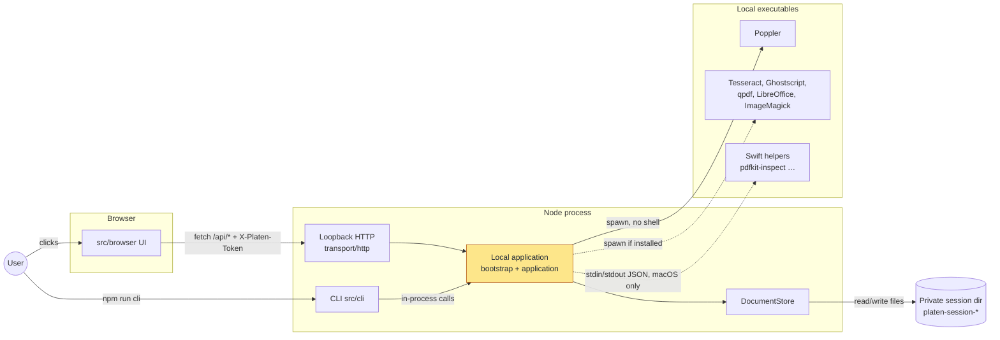
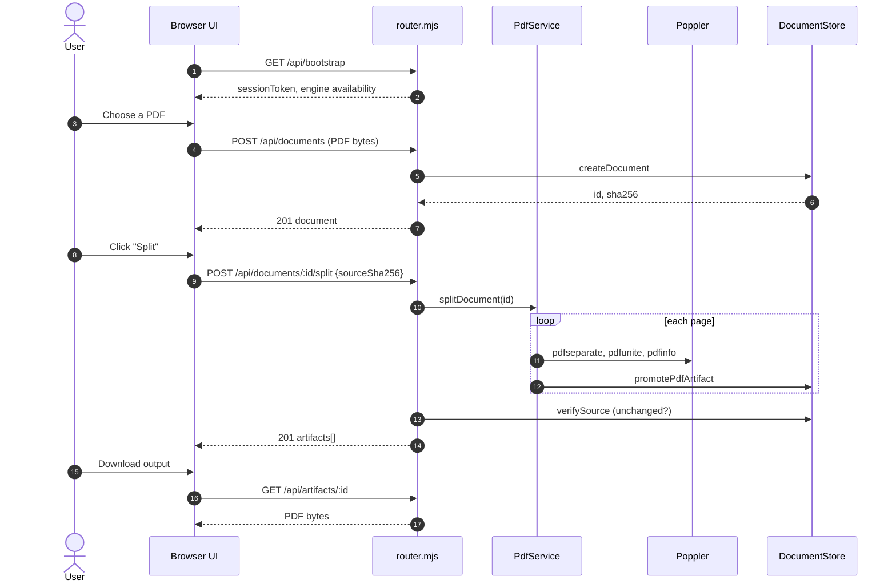
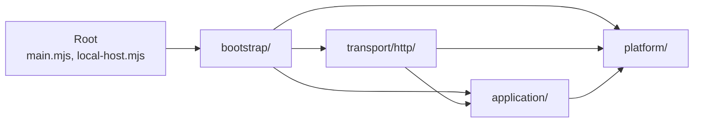
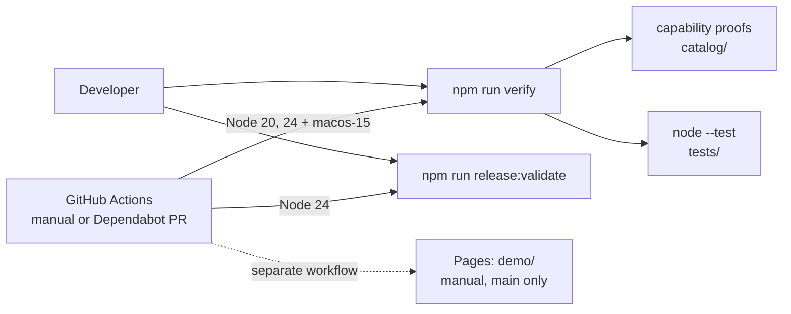

# Architecture

Platen is a local modular monolith. Browser and CLI adapters use one composed
local application; sources remain immutable and operations publish separately
validated artifacts. Optional native helpers stay behind platform adapters.

Read this page top to bottom: what runs where, what happens when you open and
split a PDF, where files live during a session, how the code is layered, and
which folder to open first.

## System overview

What runs where, and what does it talk to?

There is one Node process per session. `npm run dev` starts it with an HTTP
server bound to `127.0.0.1` (port `4173`, or `PLATEN_PORT`); the browser UI is
plain ES modules served by that same process. `npm run cli` builds the very
same local application in-process and calls it directly, without opening a
port. Every PDF engine is a separate local executable started with fixed
arguments; nothing is downloaded or uploaded. Poppler is required, the other
engines and the Swift helpers are probed at startup and reported as
unavailable when missing.

Where in the code:

- [src/host/main.mjs](../src/host/main.mjs): reads `PLATEN_PORT`, starts the host, handles `SIGINT`/`SIGTERM`.
- [src/host/local-host.mjs](../src/host/local-host.mjs): wraps the application handler in `node:http`.
- [src/host/bootstrap/local-application.mjs](../src/host/bootstrap/local-application.mjs): `createLocalApplication`, the composition root shared by host and CLI.
- [src/cli/main.mjs](../src/cli/main.mjs): `runCli`, parses arguments and dispatches commands.
- [src/host/platform/runtime/engine-registry.mjs](../src/host/platform/runtime/engine-registry.mjs): fixed executable names and search directories.
- [src/host/platform/runtime/process-runner.mjs](../src/host/platform/runtime/process-runner.mjs): `runProcess` and the bounded `createProcessLimiter` (4 concurrent, 24 queued).

## How it starts

What happens between `npm run dev` and the first page?

1. `createLocalApplication` creates a private `platen-session-*` directory
   under the OS temp directory and a random 32-byte session token.
2. It builds the stores, the process limiter, the Poppler engine runtime, and
   then stages optional native helpers: each found helper binary (for example
   `native/pdfkit-helper/.build/release/pdfkit-inspect`) is verified and copied
   into the session directory before use.
3. It wires the HTTP handler (`createAppHandler`) and the CLI facade.
4. `startLocalHost` listens on `127.0.0.1`. Non-`/api/` paths are static files
   (`index.html`, `src/`, `catalog/`); `/api/*` goes through the router.
5. On shutdown the server drops open connections (which aborts running engine
   processes) and the store deletes the session directory.

Where in the code:

- [src/host/bootstrap/optional-native-staging.mjs](../src/host/bootstrap/optional-native-staging.mjs): `stagePdfKitRuntime` and siblings.
- [src/host/platform/runtime/native-helper-loader.mjs](../src/host/platform/runtime/native-helper-loader.mjs): binary checks and pinned copy.
- [src/host/transport/http/static-files.mjs](../src/host/transport/http/static-files.mjs): `resolvePublicFile`, the static allowlist.
- [src/host/bootstrap/application-lifecycle.mjs](../src/host/bootstrap/application-lifecycle.mjs): `createApplicationClose`.

## User journey: open a PDF and split it in the browser

Which parts does a single browser action reach?

Steps 1–2 are the only unauthenticated API call: the router checks the `Host`
header and fetch metadata, then hands the browser its session token. Every
later request carries `X-Platen-Token` and must be same-origin. In step 5 the
store streams the upload into `documents/<uuid>/source.pdf`, rejects files
without a PDF header or over 512 MiB, and records its SHA-256. Step 9 sends
that hash back, so an operation always runs against the exact bytes the user
saw. In step 11 the composition executor works in a throwaway job directory,
validates each derived PDF, and only then promotes it to `artifacts/`; if any
page fails, earlier outputs of the same split are revoked. The source file is
never written to.

Where in the code:

- [src/browser/core/local-host-client.js](../src/browser/core/local-host-client.js): `bootstrap()` and the token header.
- [src/browser/api/local-host-document-endpoints.js](../src/browser/api/local-host-document-endpoints.js): `POST /api/documents`, `/split`.
- [src/host/transport/http/router.mjs](../src/host/transport/http/router.mjs): `createAppHandler`, host/token/origin checks, route order.
- [src/host/transport/http/routes/bootstrap-routes.mjs](../src/host/transport/http/routes/bootstrap-routes.mjs): `/api/bootstrap`.
- [src/host/transport/http/routes/conversion-routes.mjs](../src/host/transport/http/routes/conversion-routes.mjs): `POST /api/documents`.
- [src/host/transport/http/router-document-dispatch.mjs](../src/host/transport/http/router-document-dispatch.mjs): `/api/documents/:id/<operation>` dispatch.
- [src/host/transport/http/routes/document-service-route-mutations.mjs](../src/host/transport/http/routes/document-service-route-mutations.mjs): `splitDocument`, `publish`.
- [src/host/application/pdf/pdf-one-document-composition.mjs](../src/host/application/pdf/pdf-one-document-composition.mjs): `splitDocument`, all-or-nothing outputs.
- [src/host/application/pdf/pdf-composition-executor.mjs](../src/host/application/pdf/pdf-composition-executor.mjs): `composePages`, job workspace and validation.
- [src/host/transport/http/routes/artifact-routes.mjs](../src/host/transport/http/routes/artifact-routes.mjs): `GET`/`DELETE /api/artifacts/:id`.

Other operations follow the same shape: a route file under
`transport/http/routes/`, a service under `application/`, an adapter under
`platform/adapters/`, and a promoted artifact.

## User journey: run a CLI command

How does the CLI reach the same code without HTTP?

```mermaid
sequenceDiagram
  autonumber
  actor U as User
  participant cli as runCli
  participant app as createLocalApplication
  participant store as DocumentStore
  participant svc as Services
  participant out as verified-output
  U->>cli: npm run cli -- <command> <input.pdf>
  cli->>cli: parseCliArguments
  cli->>app: build application (no server)
  cli->>store: uploadPdf (copy input in)
  cli->>svc: run command
  svc-->>cli: artifact or report
  cli->>out: write output, no overwrite
  out-->>U: verified file or JSON
  cli->>app: close (delete session dir)
```

The CLI copies the input file into the same session store the browser path
uses (step 4), so commands get the same immutability and validation rules.
Step 7 writes to a temporary file opened with `wx`, publishes it only if the
target does not exist, and reads it back to verify the bytes before reporting
success. Commands that take no input PDF (`engines`, `help`, conversions) skip
step 4.

Where in the code:

- [src/cli/main.mjs](../src/cli/main.mjs): `runCli` and the command dispatch.
- [src/cli/parser.mjs](../src/cli/parser.mjs): `parseCliArguments`, `CLI_HELP`.
- [src/cli/runtime.mjs](../src/cli/runtime.mjs): `uploadPdf` and output helpers.
- [src/cli/verified-output.mjs](../src/cli/verified-output.mjs): `createVerifiedWriter`.
- [src/host/bootstrap/cli-application-facade.mjs](../src/host/bootstrap/cli-application-facade.mjs): the bounded `application.cli` facade.

## Where state lives

Platen has no database. Everything a session touches lives in one private
directory that is deleted on shutdown.

| Location (under `$TMPDIR/platen-session-*/`) | Holds | Owner |
| --- | --- | --- |
| `documents/<uuid>/source.pdf` | Uploaded or derived source, mode `0600`, never modified | [document-store-documents.mjs](../src/host/platform/storage/document-store-documents.mjs) |
| `artifacts/` | Validated derived outputs, served by `/api/artifacts/:id` | [document-store-artifacts.mjs](../src/host/platform/storage/document-store-artifacts.mjs) |
| `jobs/` | Per-operation scratch directories, removed after each job | [document-store-jobs.mjs](../src/host/platform/storage/document-store-jobs.mjs) |
| `inputs/`, `input-jobs/` | Non-PDF inputs for conversions (images, Office files) | [input-asset-store.mjs](../src/host/platform/storage/input-asset-store.mjs) |
| staged helper binaries | Copies of the Swift helpers used this session | [optional-native-staging.mjs](../src/host/bootstrap/optional-native-staging.mjs) |

Document and artifact records (id, display name, SHA-256, provenance) are kept
in memory by `DocumentStore`. Only CLI flags such as `--automation-root`,
`--trust-root`, `--plugin-root` and `--policy-root` point the application at directories
outside the session that persist between runs.

## Host layers

How is the host code layered, and which way may imports go?

| Layer | Location | Responsibility | May import |
| --- | --- | --- | --- |
| Root | `src/host/main.mjs`, `src/host/local-host.mjs` | Start the loopback process and expose host startup. | root, bootstrap |
| Bootstrap | `src/host/bootstrap/` | Compose concrete services, stores, runners, adapters, and handlers. | bootstrap, transport, application, platform |
| Transport | `src/host/transport/http/` | Loopback HTTP, static files, routes, request parsing, token/origin/method checks, and responses. | transport, application, platform |
| Application | `src/host/application/` | Feature behavior: automation, capabilities, documents, domains, OCR, PDF, plugins, prepress, review, and security. | application, platform |
| Platform | `src/host/platform/` | Runtime, storage, local executable, and native-helper boundaries. | platform only |

Application feature areas may depend on other application areas. Platform must
not import application. The architecture-import-boundaries test enforces these
directions and keeps concrete runtime construction in bootstrap.

## External adapters and contracts

- `src/browser/` is a browser adapter. It owns browser state, rendering, and
  loopback API clients. All endpoint factories live in `src/browser/api/`; it
  does not import host implementations.
- `src/cli/` is a CLI adapter. It owns parsing, dispatch, and no-clobber output
  publication, then uses the composed local application without starting the
  HTTP server. Its bounded `application.cli` facade owns document, artifact,
  input, provenance, and shutdown access, so commands never reach into concrete
  platform stores.
- `src/contracts/` is neutral runtime validation and shared request/result,
  error, and value definitions. It imports no browser, host, CLI, native, or
  platform-adapter implementation.
- `schemas/` validates checked-in catalog and record data. It is separate from
  runtime contracts.

## Registries

Two application modules provide bounded data-driven dispatch:

- `application/domains/domain-operation-registry.mjs` exposes a closed set of
  group/operation pairs and routes validated JSON to the domain facade.
- `application/capabilities/capability-delivery-registry.mjs` exposes a closed
  set of professional capability handlers after dedicated CLI entrypoints are
  excluded.

Both registries are fixed allowlists. They do not support runtime registration,
reflection, arbitrary method names, executable user code, or third-party
plugins. They are dispatch boundaries, not a claim that every domain operation
has an independent module or deployment boundary.

## Verification and CI

How is a change checked?

`npm run verify` checks the repository and capability-proof records, then runs
every test file under `tests/` with Node's built-in test runner. The CI
workflow runs it on Ubuntu (Node 20 and 24) and on macOS 15, but only when
started manually or for a Dependabot pull request; the repository is paused.
`release:validate` produces a local inventory receipt; it does not publish
anything. The Swift helpers are built separately with
`npm run native:build:pdfkit` and are not part of `verify`.

Where in the code:

- [tools/verify/verify.mjs](../tools/verify/verify.mjs), [tools/testing/run-tests.mjs](../tools/testing/run-tests.mjs)
- [.github/workflows/ci.yml](../.github/workflows/ci.yml), [.github/workflows/pages.yml](../.github/workflows/pages.yml)
- [docs/RELEASING.md](RELEASING.md), [docs/maintenance-checks.md](maintenance-checks.md)

## Code map

In the order a newcomer would read it:

| Path | Responsibility |
| --- | --- |
| [src/host/main.mjs](../src/host/main.mjs) | Process entry for `npm run dev`. |
| [src/host/bootstrap/](../src/host/bootstrap/) | Composition root: builds every service once. |
| [src/host/transport/http/](../src/host/transport/http/) | Router, security checks, one file per route family in `routes/`. |
| [src/host/application/](../src/host/application/) | Feature logic; `pdf/` holds most PDF operations, `ocr/`, `review/`, `prepress/`, `automation/` the rest. |
| [src/host/platform/adapters/](../src/host/platform/adapters/) | Argument builders for Poppler, Ghostscript, qpdf, Tesseract, PDFKit and others. |
| [src/host/platform/storage/](../src/host/platform/storage/) | Session store, artifacts, job workspaces, project bundles. |
| [src/contracts/](../src/contracts/) | Request/result validation shared by browser, host and CLI. |
| [src/browser/](../src/browser/) | UI: `main.js` → `bootstrap/` → `controllers/` + `ui/`, HTTP clients in `api/`. |
| [src/cli/](../src/cli/) | CLI parser, `commands/`, verified output. |
| [native/pdfkit-helper/](../native/pdfkit-helper/) | SwiftPM package with the macOS helpers (`pdfkit-inspect`, signature trust, signing identity, scanner). |
| [catalog/](../catalog/) and [schemas/](../schemas/) | Capability records shown in the UI, and their JSON Schemas. |
| [tests/](../tests/) | `contracts/` and `integration/` test suites. |
| [tools/](../tools/) | Verify, test runner, reporting, release scripts. |

## Change placement

- Compose concrete collaborators in `src/host/bootstrap/`.
- Put HTTP and static-file behavior in `src/host/transport/http/`.
- Put feature behavior in its owning `src/host/application/` area.
- Name state-aware request validation `*-admission.mjs`; import canonical wire
  identifiers from the paired neutral contract rather than redeclaring them.
- Put filesystem, process, executable, and native-helper integration in the
  appropriate `src/host/platform/` area.
- Put browser and CLI behavior in their separate adapters; put neutral shapes
  and validation in `src/contracts/`.

Preserve CLI, HTTP, native-protocol, schema, and runtime-contract compatibility
unless a change declares and tests a revision.
